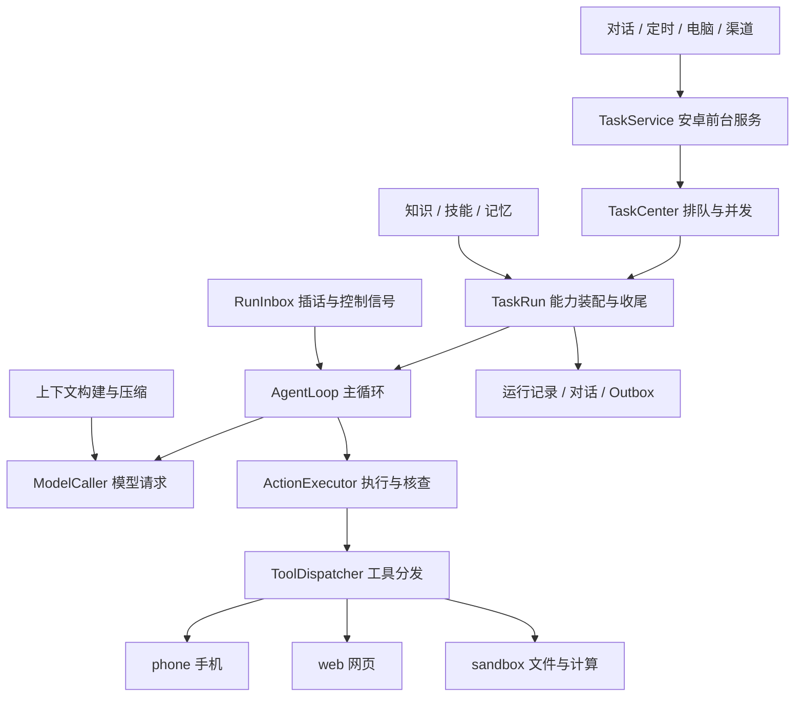

# Mika 学习路线

Mika 将纯 Kotlin/JVM 核心与 Android 宿主分开。`core` 负责模型、任务循环、工具契约和知识记忆；`app` 提供 Compose 界面、前台服务及手机、网页、沙箱实现。`tools/relay` 是可选的独立 Go 中继。

这张图表示阅读时的职责联系；具体静态依赖在 [知识图谱](knowledge-graph.json) 中。更详细的原项目说明见 [架构文档](../docs/dev/architecture.md)。

## 架构分层

| 层 | 文件级节点数 | 职责 |
| --- | ---: | --- |
| 交互界面层 | 150 | 提供 Jetpack Compose 对话与设置界面、内置浏览器、悬浮胶囊、人工接管和语音输入，把任务状态呈现给用户。 |
| Android 任务宿主层 | 78 | 通过 MikaApp、TaskService 与 TaskCenter 装配核心能力，管理任务排队、对话持久化、设置和记忆等 Android 存储实现。 |
| Agent 运行与工具引擎 | 186 | 实现平台无关的 AgentLoop、运行与插话协议、工具调度和唯一动作入口，并统一读屏状态、确认核查、触发器与运行记录。 |
| 能力与设备适配层 | 259 | 实现 phone、web、sandbox、root 和 MCP 客户端能力及其 Android 端口，承载虚拟屏、无障碍、WebView、ADB、Linux 沙箱、视觉和文件工作区。 |
| 模型、记忆与知识服务 | 63 | 封装模型调用、OAuth、网络与用量控制，提供提示词加载、记忆、知识目录、技能发现和内置文档处理脚本。 |
| 远程接入与协议层 | 39 | 连接 Android MCP 服务、核心远程任务协议和微信渠道，并提供 Python CLI、桌面任务台与独立 Go relay 网关。 |
| 测试与评测层 | 753 | 覆盖 core JVM 单元测试、Android 本地与真机测试、浏览器测试夹具、CLI 和 relay 回归，以及任务评测和模型登录检查工具。 |
| 提示词、知识资源与文档 | 283 | 保存模型提示词、内置知识与技能 Markdown、测试文本快照、用户和开发者指南、设计原型及第三方许可说明。 |
| 配置与静态资源 | 482 | 集中 Gradle 配置、Android 清单与多语言和图形资源、评测任务 JSON，以及运行环境、CLI 和 relay 的结构化配置。 |
| 构建、部署与持续集成 | 27 | 维护 Gradle 启动器、翻译检查与沙箱构建补丁，定义 relay 容器和反向代理部署及 GitHub Actions 作业与构建阶段。 |

文件级节点包含2,311个源文件，以及9个CI/容器子组件。类和函数通过 contains 关系归属源文件。

## 按顺序阅读

### 1. 先认识 Mika

先读 README，了解 Mika 如何把一句自然语言请求变成手机应用、网页与文件上的操作，并通过后台屏幕让用户继续使用手机。模型由用户配置，任务支持插话、停止和人工接管，这些产品行为会贯穿后面的代码。带着“一条任务怎样从输入走到结果”的问题继续阅读，比先记住目录名称更容易理解各层职责。

- [README.md](../README.md)

### 2. 划清核心与宿主

带着产品目标，先用架构文档和 settings.gradle.kts 确认仓库的 core、app 两个模块。core 是纯 Kotlin/JVM 模块，承载平台无关的运行逻辑；app 依赖 core，提供 Android、Compose、AIDL 与原生运行环境的装配。先建立这条边界，后面遇到能力接口和 Android 实现时，就能判断规则放在哪里、设备工作由谁完成。

- [architecture.md](../docs/dev/architecture.md)
- [settings.gradle.kts](../settings.gradle.kts)
- [build.gradle.kts](../core/build.gradle.kts)
- [build.gradle.kts](../app/build.gradle.kts)

### 3. 进入应用与界面

理解模块边界后，从 MikaApp 看 Android 进程如何延迟创建共享服务，通过 Owner 接口提供手机、网页、沙箱、模型设置与任务环境，并在启动时恢复状态。MainActivity 则负责主题、状态监控、页面导航和分享输入，把用户请求送往相应界面。把应用容器和界面入口连起来，才能继续追踪一次对话如何进入任务服务。

- [MikaApp.kt](../app/src/main/java/com/wangzan101/mika/MikaApp.kt)
- [MainActivity.kt](../app/src/main/java/com/wangzan101/mika/ui/MainActivity.kt)

语言提示：Jetpack Compose 用状态描述界面；阅读入口时，可以分别追踪页面需要的状态和用户操作触发的事件。

### 4. 追踪任务生命周期

沿着界面提交的请求，先看 TaskService 如何用 Android 前台服务承接任务与控制消息，再看 TaskCenter 管理的运行队列和 TaskCenterState 描述的插话状态。ResourceScheduler 单独协调任务之间争用的资源，TaskRun 则装配一次运行、启动 AgentLoop，并在结束后保存记录、交付结果和释放资源。把队列、资源占用和单次运行分开理解，才能判断等待、停止与收尾应由哪一层负责。

- [TaskService.kt](../app/src/main/java/com/wangzan101/mika/task/TaskService.kt)
- [TaskCenterState.kt](../app/src/main/java/com/wangzan101/mika/task/TaskCenterState.kt)
- [ResourceScheduler.kt](../app/src/main/java/com/wangzan101/mika/task/ResourceScheduler.kt)
- [TaskRun.kt](../app/src/main/java/com/wangzan101/mika/task/TaskRun.kt)

语言提示：阅读 Kotlin 协程代码时，先区分挂起等待与阻塞线程，再关注取消信号和资源释放如何贯穿任务生命周期。

### 5. 理解插话与主循环

在单次任务装配完成后，RunInbox 汇集插话、回答、确认、交回与取消信号，负责撤回和收尾时的原子交接。AgentLoop 驱动模型与工具的循环，结合 TaskState 中的运行、等待和终态协议，解释用户为何能在执行途中纠正任务。RunEvent 把过程表示为可落盘的事件，RunSink 要求记录实现隔离写盘错误，让后续观察与验证不因记录故障干扰任务。

- [RunInbox.kt](../core/src/main/kotlin/com/wangzan101/mika/core/run/RunInbox.kt)
- [AgentLoop.kt](../core/src/main/kotlin/com/wangzan101/mika/core/agent/AgentLoop.kt)
- [TaskState.kt](../core/src/main/kotlin/com/wangzan101/mika/core/agent/TaskState.kt)
- [RunEvent.kt](../core/src/main/kotlin/com/wangzan101/mika/core/record/RunEvent.kt)
- [RunSink.kt](../core/src/main/kotlin/com/wangzan101/mika/core/record/RunSink.kt)

### 6. 跟随一次模型请求

主循环需要模型给出下一步，先用 ProviderStore 理解服务商、模型及用途之间的配置关系，再进入 ModelCaller。它组装请求、转发流式输出，协调压缩、重试与模型路由，向循环返回回复和工具调用。结合 ChatModel 的错误约定与 Capabilities 的缓存类型，可以看清模型接入差异的处理边界，下一步再拆开请求中的上下文。

- [ProviderStore.kt](../app/src/main/java/com/wangzan101/mika/settings/ProviderStore.kt)
- [ModelCaller.kt](../core/src/main/kotlin/com/wangzan101/mika/core/agent/ModelCaller.kt)
- [ChatModel.kt](../core/src/main/kotlin/com/wangzan101/mika/core/model/ChatModel.kt)
- [Capabilities.kt](../core/src/main/kotlin/com/wangzan101/mika/core/model/Capabilities.kt)

### 7. 组织并保留上下文

接着看 ContextBuilder 如何把系统提示、历史、用户输入、运行状态和工具描述组合成模型上下文，并对照提示词目录说明理解这些文字的分层。ContextLimits 按整份请求计算预算，ContextCompressor 在接近预算时压缩旧消息，为长任务留出空间。再看 ContextRecovery 如何恢复被压缩过程遗漏的用户原话及固定知识、技能规则，就能理解为何节省上下文仍需保留任务依据。

- [ContextBuilder.kt](../core/src/main/kotlin/com/wangzan101/mika/core/agent/ContextBuilder.kt)
- [ContextLimits.kt](../core/src/main/kotlin/com/wangzan101/mika/core/agent/ContextLimits.kt)
- [ContextCompressor.kt](../core/src/main/kotlin/com/wangzan101/mika/core/agent/ContextCompressor.kt)
- [ContextRecovery.kt](../core/src/main/kotlin/com/wangzan101/mika/core/agent/ContextRecovery.kt)
- [README.md](../core/src/main/resources/prompts/README.md)

### 8. 从工具调用到动作

模型给出工具调用后，先从 TaskTools 看 phone、web、sandbox 如何装进同一任务，再用 ToolRegistry 理解按配置开放哪些工具。AgentLoop 将动作交给 ActionExecutor，完成检查、确认和执行后的核查；执行环节再调用 ToolDispatcher，按名称分发并整理动作后的观察。AgentTool 声明只读、写入或可能产生外部后果的性质，因此接下来的三类能力能共用同一套动作入口。

- [TaskTools.kt](../core/src/main/kotlin/com/wangzan101/mika/core/assembly/TaskTools.kt)
- [ToolRegistry.kt](../core/src/main/kotlin/com/wangzan101/mika/core/tool/ToolRegistry.kt)
- [ToolDispatcher.kt](../core/src/main/kotlin/com/wangzan101/mika/core/tool/ToolDispatcher.kt)
- [AgentTool.kt](../core/src/main/kotlin/com/wangzan101/mika/core/tool/AgentTool.kt)
- [ActionExecutor.kt](../core/src/main/kotlin/com/wangzan101/mika/core/action/ActionExecutor.kt)

### 9. 连接手机屏幕能力

承接统一动作入口，PhoneCapability 把屏幕工具、打开应用和链接组织为手机能力，ScreenPort 则定义快照、元素、动作结果及宿主操作契约。再看 PhoneServices 如何提供内置助手、配对、恢复与共享 shell 连接，把核心规则接到 Android 设备服务。AppAccessScreenPort 在读屏和动作边界核对应用归属，说明访问范围为何需要贯穿端口的每个操作。

- [PhoneCapability.kt](../core/src/main/kotlin/com/wangzan101/mika/core/cap/phone/PhoneCapability.kt)
- [ScreenPort.kt](../core/src/main/kotlin/com/wangzan101/mika/core/uistate/ScreenPort.kt)
- [PhoneServices.kt](../app/src/main/java/com/wangzan101/mika/cap/phone/PhoneServices.kt)
- [AppAccessScreenPort.kt](../core/src/main/kotlin/com/wangzan101/mika/core/uistate/AppAccessScreenPort.kt)

语言提示：Kotlin interface 可以表达核心对宿主的要求；先读端口契约，再读实现，有助于把业务规则与 Android 细节分开。

### 10. 进入网页与人工接管

沿用手机能力的阅读顺序，先看 WebCapability 与 WebPort 如何定义导航、读页、脚本和下载上传，再进入浏览器宿主。LazyWebPort 到首次打开网址才创建网页环境，WebTab 管理 WebView 及加载状态，使只用手机的任务不必提前承担浏览器成本。WebTakeoverPage 把同一个 WebView 移到用户面前并在结束后归还，连接了前面主循环中的接管等待与实际页面操作。

- [WebCapability.kt](../core/src/main/kotlin/com/wangzan101/mika/core/cap/web/WebCapability.kt)
- [WebPort.kt](../core/src/main/kotlin/com/wangzan101/mika/core/cap/web/WebPort.kt)
- [LazyWebPort.kt](../app/src/main/java/com/wangzan101/mika/cap/web/LazyWebPort.kt)
- [WebTab.kt](../app/src/main/java/com/wangzan101/mika/cap/web/WebTab.kt)
- [WebTakeoverPage.kt](../app/src/main/java/com/wangzan101/mika/cap/web/WebTakeoverPage.kt)

### 11. 进入沙箱与工作区

再把视线从屏幕转到文件：SandboxCapability 提供命令、技能脚本与工作区文件，并使用独立的沙箱守卫；SandboxPort 让脚本请求的手机工具回到本任务的动作入口。RuntimePreparer 在后台准备本地运行环境，SandboxTree 协调写入与重置的互斥，再结合沙箱文档理解运行环境如何构建和交付。这样就能把前面的网页下载、附件和后续技能脚本放到同一个文件生命周期中理解。

- [SandboxCapability.kt](../core/src/main/kotlin/com/wangzan101/mika/core/cap/sandbox/SandboxCapability.kt)
- [SandboxPort.kt](../core/src/main/kotlin/com/wangzan101/mika/core/cap/sandbox/SandboxPort.kt)
- [RuntimePreparer.kt](../app/src/main/java/com/wangzan101/mika/cap/sandbox/RuntimePreparer.kt)
- [SandboxTree.kt](../core/src/main/kotlin/com/wangzan101/mika/core/workspace/SandboxTree.kt)
- [README.md](../tools/sandbox/README.md)

### 12. 积累知识与个人记忆

有了工具和文件环境，再看 KnowledgeStore 与 GuideCatalog 如何读取、检索应用知识、站点知识和个人技能，为前面的上下文及能力提供使用方法。MemoryStore 定义个人记忆的存取边界，EncryptedMemoryFile 用加密文件和原子替换承接 Android 持久化，让跨任务信息有明确的保存位置。AppKnowledgeLearning 还把运行结果转成知识草稿与试用阶段，说明经验如何经过版本选择逐步进入后续任务。

- [KnowledgeStore.kt](../core/src/main/kotlin/com/wangzan101/mika/core/knowledge/KnowledgeStore.kt)
- [GuideCatalog.kt](../core/src/main/kotlin/com/wangzan101/mika/core/knowledge/GuideCatalog.kt)
- [MemoryStore.kt](../core/src/main/kotlin/com/wangzan101/mika/core/memory/MemoryStore.kt)
- [EncryptedMemoryFile.kt](../app/src/main/java/com/wangzan101/mika/memory/EncryptedMemoryFile.kt)
- [AppKnowledgeLearning.kt](../core/src/main/kotlin/com/wangzan101/mika/core/knowledge/AppKnowledgeLearning.kt)

### 13. 让计划触发任务

理解一次手动任务后，再看 Triggers 如何原子领取到期窗口、推进下次时间，并通过持久化账本支持恢复后的去重派发。TriggerRuntime 是 Android 闹钟的薄壳，允许广播重复到达；FileTriggerStore 将条件计划的扩展状态单独保存，兼顾旧版读取。这个分工把“何时应当运行”的判断留在可恢复的状态中，把系统唤醒留给宿主，解释定时任务为何不能只依赖一次闹钟回调。

- [Triggers.kt](../core/src/main/kotlin/com/wangzan101/mika/core/trigger/Triggers.kt)
- [TriggerRuntime.kt](../app/src/main/java/com/wangzan101/mika/task/TriggerRuntime.kt)
- [FileTriggerStore.kt](../app/src/main/java/com/wangzan101/mika/task/FileTriggerStore.kt)

### 14. 从电脑接入任务

把前面的任务入口延伸到电脑，先按使用指南区分 CLI + Skill 与 MCP，再区分 USB、Wi-Fi 或 VPN 等连接方式。McpRpc 适配 MCP 的 JSON-RPC 请求，RemoteTaskHub 提供按令牌归属限定的电脑任务视图，让远程请求进入既有任务体系。需要自建中继时，RelayClient 只接收已配对 TLS 网关的请求，部署配置用 relay 与 Caddy 提供 HTTPS 服务。连接可以重建但请求不重放，这一点解释了远程传输恢复为何必须与已经执行的动作分开处理。

- [computer.md](../docs/computer.md)
- [McpRpc.kt](../core/src/main/kotlin/com/wangzan101/mika/core/mcp/McpRpc.kt)
- [RemoteTaskHub.kt](../app/src/main/java/com/wangzan101/mika/task/RemoteTaskHub.kt)
- [RelayClient.kt](../core/src/main/kotlin/com/wangzan101/mika/core/remote/RelayClient.kt)
- [compose.yaml](../tools/relay/compose.yaml)

### 15. 用测试验证全链路

走完整条任务路径后，用 RunInboxTest 的撤回与取出竞争场景、ContextCompressorTest 的上下文预算场景，以及远程任务真机恢复测试，检验前面读到的关键约定。ci.yml 把 core JVM、Python CLI、Android App 与 Go relay 分成四项作业，执行相关测试、网关集成与调试 APK 构建。结合贡献指南选择对应验证入口，就能把对架构的理解转成修改代码时可重复检查的行为。

- [RunInboxTest.kt](../core/src/test/kotlin/com/wangzan101/mika/core/run/RunInboxTest.kt)
- [ContextCompressorTest.kt](../core/src/test/kotlin/com/wangzan101/mika/core/agent/ContextCompressorTest.kt)
- [RemoteTaskRecoveryDeviceTest.kt](../app/src/androidTest/java/com/wangzan101/mika/task/RemoteTaskRecoveryDeviceTest.kt)
- [ci.yml](../.github/workflows/ci.yml)
- [CONTRIBUTING.zh-CN.md](../.github/CONTRIBUTING.zh-CN.md)

## 使用与验证

在技能仪表盘中按架构层过滤或搜索符号；`tested_by` 指向测试，`documents` 从文档指向被说明对象。`calls` 是带来源说明的静态候选关系。

打开方式和本地校验命令见 [图谱说明](README.md)；范围与解析限制见 [分析报告](analysis-report.json)。
