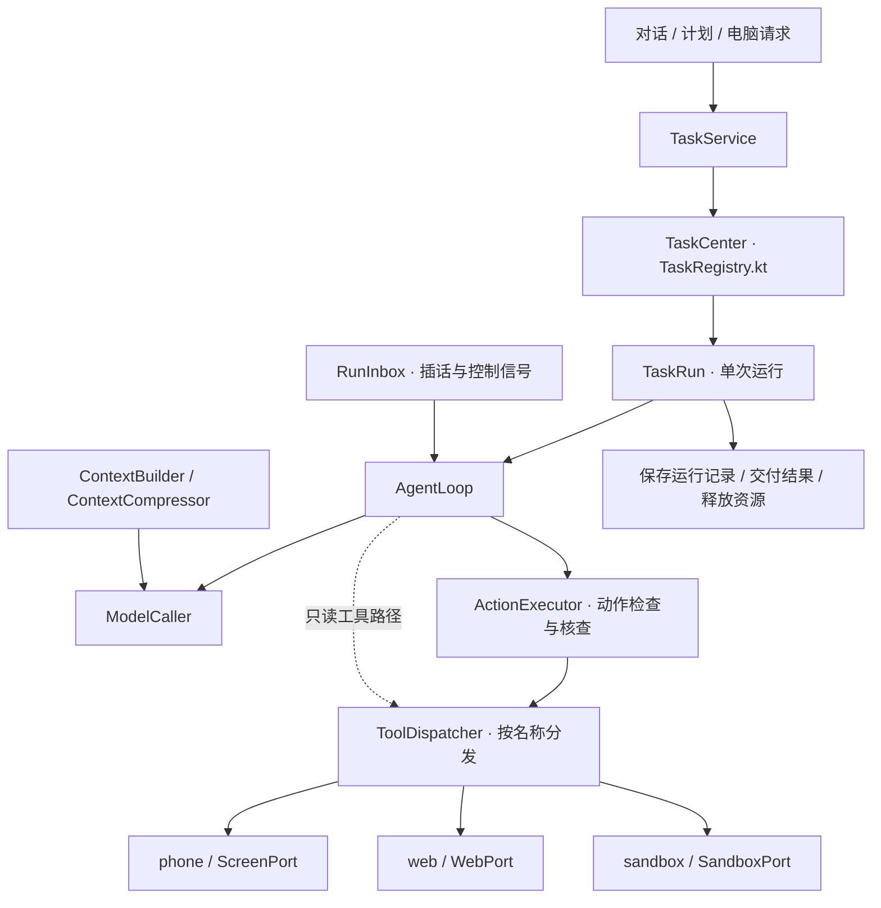

# Mika 开发者入门指南

由 [Understand-Anything 的 understand-onboard 技能](https://github.com/Egonex-AI/Understand-Anything/blob/a6ea4024767df85ce4f99140d4f12ecfc5a81eb6/understand-anything-plugin/skills/understand-onboard/SKILL.md)基于 [知识图谱](../.ua/knowledge-graph.json)生成，适合第一次阅读或准备修改 Mika 的开发者。

图谱源码基准：`f3bbbdf92caeb4259d55922e12f61f6da11469fd`。生成前已核对 `study-notes` 的 `7fb00b2`：相对图谱基准仅增加 `.ua/` 产物，项目源码没有漂移。指南沿用图谱的10个分层和15步导览，关键入口与开发命令另据源码及仓库文档核对。

## 1. 项目概览

Mika 是 Android AI 助手，把自然语言任务转成手机应用、网页和文件上的操作。它通过后台屏幕执行手机操作，并提供内置浏览器与 Linux 沙箱；用户可以在执行途中插话、停止或接管。电脑侧可通过 Python CLI 或 MCP 接入，独立 Go 中继提供可选的远程连接。

代码主体是 Kotlin。图谱还识别出 Java、C、AIDL、Python、Go、JavaScript、HTML/CSS，以及 XML、JSON、YAML、TOML 等资源和配置格式。主要框架及工具包括 Android、Jetpack Compose、JUnit、Gradle、Docker、Docker Compose 和 GitHub Actions。

| 部分 | 技术与职责 | 起点 |
| --- | --- | --- |
| `core` | 纯 Kotlin/JVM；主循环、模型接口、工具契约、知识记忆、提示词及平台无关能力 | [核心构建配置][corebuild]、[AgentLoop][loop] |
| `app` | Android、Compose；界面、服务、存储及设备端口实现 | [MikaApp][app]、[MainActivity][main] |
| `tools/mika` | Python CLI 与本地桌面任务台 | [mika_cli.py][cli] |
| `tools/relay` | 可选的独立 Go 中继，不进入 APK | [main.go][relaymain]、[compose.yaml][compose] |

### 先准备可重复的验证入口

以[贡献指南][contrib]为准准备 JDK 17 和 Android SDK；SDK 路径通过 `local.properties` 的 `sdk.dir` 或 `ANDROID_HOME` 提供。当前 App 配置为 `compileSdk = 36`、`minSdk = 30`、`targetSdk = 35`。CLI 需要 Python 3.10+；Go 版本以 [go.mod](../tools/relay/go.mod)为准，当前声明为1.23。

在仓库根目录按改动范围选择命令：

| 目标 | 命令 |
| --- | --- |
| 核心 JVM 行为 | `./gradlew :core:test` |
| Python CLI 与跨语言契约 | `./gradlew :core:cliTest -PmikaPython=python3` |
| Android 本地单测与调试包 | `./gradlew :app:testDebugUnitTest :app:assembleDebug` |
| Go 中继集成 | `./gradlew :core:relayTest` |
| 翻译工具与资源检查 | `python3 -m unittest discover -s tools/i18n -v`；`python3 tools/i18n/translations.py check` |

这些是仓库现有的验证入口，本次生成文档没有执行上述业务测试或构建。[CI 配置][ci]在 PR、推送到 `main` 或手动触发时运行，单独推送 `study-notes` 不会自动触发其 push 作业。需要真实设备的验证另见[真机评测说明][eval]。

## 2. 架构分层

仓库只有 `core`、`app` 两个 Gradle 模块。下面10层是图谱的阅读分组，不代表10个编译模块。文件级节点共2,320个，包含2,311个实际文件和9个 CI/容器子组件；类与函数不单独列入本指南的文件地图。

| 图谱层 | 文件级节点 | 职责 | 优先打开 |
| --- | ---: | --- | --- |
| 交互界面层 | 150 | 提供 Jetpack Compose 对话与设置界面、内置浏览器、悬浮胶囊、人工接管和语音输入，把任务状态呈现给用户。 | [MainActivity.kt][main]、[ChatViewModel.kt][chatvm] |
| Android 任务宿主层 | 78 | 通过 MikaApp、TaskService 与 TaskCenter 装配核心能力，管理任务排队、对话持久化、设置和记忆等 Android 存储实现。 | [TaskService.kt][service]、[TaskRegistry.kt][center]、[TaskRun.kt][run] |
| Agent 运行与工具引擎 | 186 | 实现平台无关的 AgentLoop、运行与插话协议、工具调度和唯一动作入口，并统一读屏状态、确认核查、触发器与运行记录。 | [AgentLoop.kt][loop]、[ActionExecutor.kt][executor]、[ToolDispatcher.kt][dispatcher] |
| 能力与设备适配层 | 259 | 实现 phone、web、sandbox、root 和 MCP 客户端能力及其 Android 端口，承载虚拟屏、无障碍、WebView、ADB、Linux 沙箱、视觉和文件工作区。 | [AndroidScreen.kt][androidscreen]、[WebScreen.kt][webscreen]、[AndroidSandbox.kt][androidsandbox] |
| 模型、记忆与知识服务 | 63 | 封装模型调用、OAuth、网络与用量控制，提供提示词加载、记忆、知识目录、技能发现和内置文档处理脚本。 | [ChatModel.kt][model]、[GuideCatalog.kt][catalog]、[MemoryStore.kt][memory] |
| 远程接入与协议层 | 39 | 连接 Android MCP 服务、核心远程任务协议和微信渠道，并提供 Python CLI、桌面任务台与独立 Go relay 网关。 | [McpRpc.kt][mcp]、[mika_cli.py][cli]、[main.go][relaymain] |
| 测试与评测层 | 753 | 覆盖 core JVM 单元测试、Android 本地与真机测试、浏览器测试夹具、CLI 和 relay 回归，以及任务评测和模型登录检查工具。 | [AgentLoopTest.kt][looptest]、[PackageDependencyTest.kt][packagetest]、[RemoteTaskRecoveryDeviceTest.kt][recoverytest] |
| 提示词、知识资源与文档 | 283 | 保存模型提示词、内置知识与技能 Markdown、测试文本快照、用户和开发者指南、设计原型及第三方许可说明。 | [architecture.md][arch]、[knowledge-format.md][knowledgeformat]、[prompts/README.md][prompts] |
| 配置与静态资源 | 482 | 集中 Gradle 配置、Android 清单与多语言和图形资源、评测任务 JSON，以及运行环境、CLI 和 relay 的结构化配置。 | [settings.gradle.kts][settings]、[core/build.gradle.kts][corebuild]、[app/build.gradle.kts][appbuild] |
| 构建、部署与持续集成 | 27 | 维护 Gradle 启动器、翻译检查与沙箱构建补丁，定义 relay 容器和反向代理部署及 GitHub Actions 作业与构建阶段。 | [ci.yml][ci]、[compose.yaml][compose]、[build-runtime.py][runtimebuild] |

### 跟随一条任务

下面表示主要职责与动作路径；具体入口还有只读调用、批处理、重放和脚本子动作等分支。

动作顺序可在 [AgentLoop.kt][loop] 中的 `executor.run` 和 [ActionExecutor.kt][executor] 中的 `tools.execute` 直接核对。`TaskCenter` 的定义位于 [TaskRegistry.kt][center]；`TaskCenterState.kt` 主要承载界面要显示的状态，读队列实现时要打开前者。

## 3. 关键概念

### 平台边界与能力装配

`core` 的规则通过端口要求宿主提供操作；`app` 实现这些端口。先读 [ScreenPort][screenport]、[WebPort][webport]、[SandboxPort][sandboxport]，再读具体 Android 实现。各能力不直接互相依赖，装配层 [TaskTools][assembly] 同时认识手机、网页和沙箱；[PackageDependencyTest][packagetest]约束依赖方向。增加能力时，先确定接口和装配位置，再接入宿主。

### 对话、运行、排队与插话

一个对话可以持续多轮，一次运行由 [TaskRun][run]负责；[TaskCenter][center]管理按对话索引的运行和并行队列。同一对话运行中发来的新消息可能成为插话，也可以排队成为下一件任务。[RunInbox][inbox]负责消息接收、撤回、取出和收尾交接，[TaskState][state]描述当前执行或等待状态。修改这里时，先分清是在改变消息去向、任务调度，还是界面显示。

### 动作入口、只读工具与执行后的观察

模型选出工具，并不等于动作已经完成。改变屏幕、网页或沙箱的调用经过 [ActionExecutor][executor]，再由 [ToolDispatcher][dispatcher]分发；执行入口统一处理守卫、确认、记录和事后核查。只读路径使用 `executeRead`，它会拒绝声明为非只读的工具。工具返回、观察到的变化和最后向用户报告的结论，应沿着同一份执行证据理解；新增工具可先对照[动作来源测试][actiontest]。

### 上下文预算与恢复

[ContextBuilder][context]组织提示词、历史和能力说明，[ModelCaller][caller]协调模型请求，[ContextCompressor][compressor]处理预算压力。[ContextRecovery][recovery]在压缩后恢复遗漏的用户原话与固定知识、技能规则。阅读时同时看[提示词目录说明][prompts]和[压缩测试][contexttest]，关注“哪些消息可以折叠、哪些依据必须保留”，不要只看消息数量是否减少。

### 知识、技能与个人记忆

[KnowledgeStore][knowledge]与 [GuideCatalog][catalog]提供 App、网站知识及技能的读取和检索；这些内容的格式见[知识格式说明][knowledgeformat]。[MemoryStore][memory]表达个人记忆的存取边界，Android 落盘由 [EncryptedMemoryFile][memoryfile]等宿主实现承担。[AppKnowledgeLearning][learning]管理草稿、试用和版本选择。修改内置规则、运行时知识选择与用户记忆，需要进入不同的文件。

### 本地任务与远程接入

[McpRpc][mcp]和 [RemoteTaskApi][taskapi]把电脑请求接入已有任务体系；[RemoteTaskHub][hub]要求外部访问使用限定令牌归属的视图。[RelayClient][relay]允许连接重建，但不会重放请求，也不会把断线描述成已撤销外部动作。理解远程失败时要分开追踪“连接是否存活”“任务是否结束”“操作是否已经发生”，再对照[中继集成测试][relaytest]和[真机恢复测试][recoverytest]。

### 恢复与收尾也是正常执行路径

[Triggers][triggers]通过持久化窗口账本处理恢复后的派发，[TaskRun][run]在结束时交还页面、保存记录并释放资源。协程取消可能发生在动作之后；阅读资源生命周期时，要把正常完成、异常和取消三个出口一起看。任务结束后的记录与结果交付也是理解用户最终看到什么的必要部分。

## 4. 引导式导览

沿用图谱的15步顺序。第一遍先完成第1–8步，建立从用户输入到动作执行的完整路径；第二遍按需要选读第9–14步的能力与接入；第15步把阅读所得对应到验证入口。每步的“读完后检查”用于确认理解，不需要为了完成阅读而修改代码。

### 1. 先认识 Mika

先读 README，了解 Mika 如何把一句自然语言请求变成手机应用、网页与文件上的操作，并通过后台屏幕让用户继续使用手机。模型由用户配置，任务支持插话、停止和人工接管，这些产品行为会贯穿后面的代码。带着“一条任务怎样从输入走到结果”的问题继续阅读，比先记住目录名称更容易理解各层职责。

阅读入口：[README.md](../README.md)。

读完后检查：这次任务会用到手机、网页还是文件能力？用户怎样插话、停止或接管？

### 2. 划清核心与宿主

带着产品目标，先用架构文档和 settings.gradle.kts 确认仓库的 core、app 两个模块。core 是纯 Kotlin/JVM 模块，承载平台无关的运行逻辑；app 依赖 core，提供 Android、Compose、AIDL 与原生运行环境的装配。先建立这条边界，后面遇到能力接口和 Android 实现时，就能判断规则放在哪里、设备工作由谁完成。

阅读入口：[architecture.md](../docs/dev/architecture.md) → [settings.gradle.kts](../settings.gradle.kts) → [core/build.gradle.kts](../core/build.gradle.kts) → [app/build.gradle.kts](../app/build.gradle.kts)。

读完后检查：一项新规则应该留在 core，还是依赖 Android、放进 app？

### 3. 进入应用与界面

理解模块边界后，从 MikaApp 看 Android 进程如何延迟创建共享服务，通过 Owner 接口提供手机、网页、沙箱、模型设置与任务环境，并在启动时恢复状态。MainActivity 则负责主题、状态监控、页面导航和分享输入，把用户请求送往相应界面。把应用容器和界面入口连起来，才能继续追踪一次对话如何进入任务服务。

阅读入口：[MikaApp.kt](../app/src/main/java/com/wangzan101/mika/MikaApp.kt) → [MainActivity.kt](../app/src/main/java/com/wangzan101/mika/ui/MainActivity.kt)。

读完后检查：进程共享服务由谁持有，界面事件又从哪里进入任务层？

语言提示：Jetpack Compose 用状态描述界面；阅读入口时，可以分别追踪页面需要的状态和用户操作触发的事件。

### 4. 追踪任务生命周期

沿着界面提交的请求，先看 TaskService 如何用 Android 前台服务承接任务与控制消息，再看 TaskCenter 管理的运行队列和 TaskCenterState 描述的插话状态。ResourceScheduler 单独协调任务之间争用的资源，TaskRun 则装配一次运行、启动 AgentLoop，并在结束后保存记录、交付结果和释放资源。把队列、资源占用和单次运行分开理解，才能判断等待、停止与收尾应由哪一层负责。

阅读入口：[TaskService.kt](../app/src/main/java/com/wangzan101/mika/task/TaskService.kt) → [TaskRegistry.kt](../app/src/main/java/com/wangzan101/mika/task/TaskRegistry.kt) → [TaskCenterState.kt](../app/src/main/java/com/wangzan101/mika/task/TaskCenterState.kt) → [ResourceScheduler.kt](../app/src/main/java/com/wangzan101/mika/task/ResourceScheduler.kt) → [TaskRun.kt](../app/src/main/java/com/wangzan101/mika/task/TaskRun.kt)。

读完后检查：等待的是队列位置、共享资源还是用户操作？TaskCenter、TaskRun 和界面状态各负责什么？

语言提示：阅读 Kotlin 协程代码时，先区分挂起等待与阻塞线程，再关注取消信号和资源释放如何贯穿任务生命周期。

### 5. 理解插话与主循环

在单次任务装配完成后，RunInbox 汇集插话、回答、确认、交回与取消信号，负责撤回和收尾时的原子交接。AgentLoop 驱动模型与工具的循环，结合 TaskState 中的运行、等待和终态协议，解释用户为何能在执行途中纠正任务。RunEvent 把过程表示为可落盘的事件，RunSink 要求记录实现隔离写盘错误，让后续观察与验证不因记录故障干扰任务。

阅读入口：[RunInbox.kt](../core/src/main/kotlin/com/wangzan101/mika/core/run/RunInbox.kt) → [AgentLoop.kt](../core/src/main/kotlin/com/wangzan101/mika/core/agent/AgentLoop.kt) → [TaskState.kt](../core/src/main/kotlin/com/wangzan101/mika/core/agent/TaskState.kt) → [RunEvent.kt](../core/src/main/kotlin/com/wangzan101/mika/core/record/RunEvent.kt) → [RunSink.kt](../core/src/main/kotlin/com/wangzan101/mika/core/record/RunSink.kt)。

读完后检查：插话已接收、已交给模型和任务已收尾分别意味着什么？撤回与取出竞争由谁处理？

### 6. 跟随一次模型请求

主循环需要模型给出下一步，先用 ProviderStore 理解服务商、模型及用途之间的配置关系，再进入 ModelCaller。它组装请求、转发流式输出，协调压缩、重试与模型路由，向循环返回回复和工具调用。结合 ChatModel 的错误约定与 Capabilities 的缓存类型，可以看清模型接入差异的处理边界，下一步再拆开请求中的上下文。

阅读入口：[ProviderStore.kt](../app/src/main/java/com/wangzan101/mika/settings/ProviderStore.kt) → [ModelCaller.kt](../core/src/main/kotlin/com/wangzan101/mika/core/agent/ModelCaller.kt) → [ChatModel.kt](../core/src/main/kotlin/com/wangzan101/mika/core/model/ChatModel.kt) → [Capabilities.kt](../core/src/main/kotlin/com/wangzan101/mika/core/model/Capabilities.kt)。

读完后检查：模型配置、请求组装和错误重试分别在哪里？工具调用从哪种返回结果进入循环？

### 7. 组织并保留上下文

接着看 ContextBuilder 如何把系统提示、历史、用户输入、运行状态和工具描述组合成模型上下文，并对照提示词目录说明理解这些文字的分层。ContextLimits 按整份请求计算预算，ContextCompressor 在接近预算时压缩旧消息，为长任务留出空间。再看 ContextRecovery 如何恢复被压缩过程遗漏的用户原话及固定知识、技能规则，就能理解为何节省上下文仍需保留任务依据。

阅读入口：[ContextBuilder.kt](../core/src/main/kotlin/com/wangzan101/mika/core/agent/ContextBuilder.kt) → [ContextLimits.kt](../core/src/main/kotlin/com/wangzan101/mika/core/agent/ContextLimits.kt) → [ContextCompressor.kt](../core/src/main/kotlin/com/wangzan101/mika/core/agent/ContextCompressor.kt) → [ContextRecovery.kt](../core/src/main/kotlin/com/wangzan101/mika/core/agent/ContextRecovery.kt) → [prompts/README.md](../core/src/main/resources/prompts/README.md)。

读完后检查：压缩后哪些内容必须保留？如何验证用户原话和固定规则没有丢失？

### 8. 从工具调用到动作

模型给出工具调用后，先从 TaskTools 看 phone、web、sandbox 如何装进同一任务，再用 ToolRegistry 理解按配置开放哪些工具。AgentLoop 将动作交给 ActionExecutor，完成检查、确认和执行后的核查；执行环节再调用 ToolDispatcher，按名称分发并整理动作后的观察。AgentTool 声明只读、写入或可能产生外部后果的性质，因此接下来的三类能力能共用同一套动作入口。

阅读入口：[TaskTools.kt](../core/src/main/kotlin/com/wangzan101/mika/core/assembly/TaskTools.kt) → [ToolRegistry.kt](../core/src/main/kotlin/com/wangzan101/mika/core/tool/ToolRegistry.kt) → [ToolDispatcher.kt](../core/src/main/kotlin/com/wangzan101/mika/core/tool/ToolDispatcher.kt) → [AgentTool.kt](../core/src/main/kotlin/com/wangzan101/mika/core/tool/AgentTool.kt) → [ActionExecutor.kt](../core/src/main/kotlin/com/wangzan101/mika/core/action/ActionExecutor.kt)。

读完后检查：为什么有副作用的工具不能直接走 executeRead？动作入口如何回到具体工具？

### 9. 连接手机屏幕能力

承接统一动作入口，PhoneCapability 把屏幕工具、打开应用和链接组织为手机能力，ScreenPort 则定义快照、元素、动作结果及宿主操作契约。再看 PhoneServices 如何提供内置助手、配对、恢复与共享 shell 连接，把核心规则接到 Android 设备服务。AppAccessScreenPort 在读屏和动作边界核对应用归属，说明访问范围为何需要贯穿端口的每个操作。

阅读入口：[PhoneCapability.kt](../core/src/main/kotlin/com/wangzan101/mika/core/cap/phone/PhoneCapability.kt) → [ScreenPort.kt](../core/src/main/kotlin/com/wangzan101/mika/core/uistate/ScreenPort.kt) → [PhoneServices.kt](../app/src/main/java/com/wangzan101/mika/cap/phone/PhoneServices.kt) → [AppAccessScreenPort.kt](../core/src/main/kotlin/com/wangzan101/mika/core/uistate/AppAccessScreenPort.kt)。

读完后检查：核心端口与 Android 实现如何分工？一次点击之后怎样确认观察对应的是当前屏幕？

语言提示：Kotlin interface 可以表达核心对宿主的要求；先读端口契约，再读实现，有助于把业务规则与 Android 细节分开。

### 10. 进入网页与人工接管

沿用手机能力的阅读顺序，先看 WebCapability 与 WebPort 如何定义导航、读页、脚本和下载上传，再进入浏览器宿主。LazyWebPort 到首次打开网址才创建网页环境，WebTab 管理 WebView 及加载状态，使只用手机的任务不必提前承担浏览器成本。WebTakeoverPage 把同一个 WebView 移到用户面前并在结束后归还，连接了前面主循环中的接管等待与实际页面操作。

阅读入口：[WebCapability.kt](../core/src/main/kotlin/com/wangzan101/mika/core/cap/web/WebCapability.kt) → [WebPort.kt](../core/src/main/kotlin/com/wangzan101/mika/core/cap/web/WebPort.kt) → [LazyWebPort.kt](../app/src/main/java/com/wangzan101/mika/cap/web/LazyWebPort.kt) → [WebTab.kt](../app/src/main/java/com/wangzan101/mika/cap/web/WebTab.kt) → [WebTakeoverPage.kt](../app/src/main/java/com/wangzan101/mika/cap/web/WebTakeoverPage.kt)。

读完后检查：页面、标签和用户接管分别由谁持有？何时可以创建、移动和释放 WebView？

### 11. 进入沙箱与工作区

再把视线从屏幕转到文件：SandboxCapability 提供命令、技能脚本与工作区文件，并使用独立的沙箱守卫；SandboxPort 让脚本请求的手机工具回到本任务的动作入口。RuntimePreparer 在后台准备本地运行环境，SandboxTree 协调写入与重置的互斥，再结合沙箱文档理解运行环境如何构建和交付。这样就能把前面的网页下载、附件和后续技能脚本放到同一个文件生命周期中理解。

阅读入口：[SandboxCapability.kt](../core/src/main/kotlin/com/wangzan101/mika/core/cap/sandbox/SandboxCapability.kt) → [SandboxPort.kt](../core/src/main/kotlin/com/wangzan101/mika/core/cap/sandbox/SandboxPort.kt) → [RuntimePreparer.kt](../app/src/main/java/com/wangzan101/mika/cap/sandbox/RuntimePreparer.kt) → [SandboxTree.kt](../core/src/main/kotlin/com/wangzan101/mika/core/workspace/SandboxTree.kt) → [README.md](../tools/sandbox/README.md)。

读完后检查：命令进程、工作区文件和导出额度分别在哪里管理？取消后还有哪些资源需要回收？

### 12. 积累知识与个人记忆

有了工具和文件环境，再看 KnowledgeStore 与 GuideCatalog 如何读取、检索应用知识、站点知识和个人技能，为前面的上下文及能力提供使用方法。MemoryStore 定义个人记忆的存取边界，EncryptedMemoryFile 用加密文件和原子替换承接 Android 持久化，让跨任务信息有明确的保存位置。AppKnowledgeLearning 还把运行结果转成知识草稿与试用阶段，说明经验如何经过版本选择逐步进入后续任务。

阅读入口：[KnowledgeStore.kt](../core/src/main/kotlin/com/wangzan101/mika/core/knowledge/KnowledgeStore.kt) → [GuideCatalog.kt](../core/src/main/kotlin/com/wangzan101/mika/core/knowledge/GuideCatalog.kt) → [MemoryStore.kt](../core/src/main/kotlin/com/wangzan101/mika/core/memory/MemoryStore.kt) → [EncryptedMemoryFile.kt](../app/src/main/java/com/wangzan101/mika/memory/EncryptedMemoryFile.kt) → [AppKnowledgeLearning.kt](../core/src/main/kotlin/com/wangzan101/mika/core/knowledge/AppKnowledgeLearning.kt)。

读完后检查：内置知识、个人技能、个人记忆和试用草稿的存放与选择方式有何不同？

### 13. 让计划触发任务

理解一次手动任务后，再看 Triggers 如何原子领取到期窗口、推进下次时间，并通过持久化账本支持恢复后的去重派发。TriggerRuntime 是 Android 闹钟的薄壳，允许广播重复到达；FileTriggerStore 将条件计划的扩展状态单独保存，兼顾旧版读取。这个分工把“何时应当运行”的判断留在可恢复的状态中，把系统唤醒留给宿主，解释定时任务为何不能只依赖一次闹钟回调。

阅读入口：[Triggers.kt](../core/src/main/kotlin/com/wangzan101/mika/core/trigger/Triggers.kt) → [TriggerRuntime.kt](../app/src/main/java/com/wangzan101/mika/task/TriggerRuntime.kt) → [FileTriggerStore.kt](../app/src/main/java/com/wangzan101/mika/task/FileTriggerStore.kt)。

读完后检查：重复唤醒或进程恢复后，哪个账本决定这一个窗口是否已经派发？

### 14. 从电脑接入任务

把前面的任务入口延伸到电脑，先按使用指南区分 CLI + Skill 与 MCP，再区分 USB、Wi-Fi 或 VPN 等连接方式。McpRpc 适配 MCP 的 JSON-RPC 请求，RemoteTaskHub 提供按令牌归属限定的电脑任务视图，让远程请求进入既有任务体系。需要自建中继时，RelayClient 只接收已配对 TLS 网关的请求，部署配置用 relay 与 Caddy 提供 HTTPS 服务。连接可以重建但请求不重放，这一点解释了远程传输恢复为何必须与已经执行的动作分开处理。

阅读入口：[computer.md](../docs/computer.md) → [McpRpc.kt](../core/src/main/kotlin/com/wangzan101/mika/core/mcp/McpRpc.kt) → [RemoteTaskHub.kt](../app/src/main/java/com/wangzan101/mika/task/RemoteTaskHub.kt) → [RelayClient.kt](../core/src/main/kotlin/com/wangzan101/mika/core/remote/RelayClient.kt) → [compose.yaml](../tools/relay/compose.yaml)。

读完后检查：电脑侧令牌能看到哪些任务？连接断开时哪些状态仍可能继续存在？

### 15. 用测试验证全链路

走完整条任务路径后，用 RunInboxTest 的撤回与取出竞争场景、ContextCompressorTest 的上下文预算场景，以及远程任务真机恢复测试，检验前面读到的关键约定。ci.yml 把 core JVM、Python CLI、Android App 与 Go relay 分成四项作业，执行相关测试、网关集成与调试 APK 构建。结合贡献指南选择对应验证入口，就能把对架构的理解转成修改代码时可重复检查的行为。

阅读入口：[RunInboxTest.kt](../core/src/test/kotlin/com/wangzan101/mika/core/run/RunInboxTest.kt) → [ContextCompressorTest.kt](../core/src/test/kotlin/com/wangzan101/mika/core/agent/ContextCompressorTest.kt) → [RemoteTaskRecoveryDeviceTest.kt](../app/src/androidTest/java/com/wangzan101/mika/task/RemoteTaskRecoveryDeviceTest.kt) → [ci.yml](../.github/workflows/ci.yml) → [CONTRIBUTING.zh-CN.md](../.github/CONTRIBUTING.zh-CN.md)。

读完后检查：准备修改的行为应该由核心单测、Android 本地单测、真机测试还是中继集成来验证？

## 5. 文件地图

下面按图谱分层列出常用定位点；完整清单见[交互图谱说明](../.ua/README.md)。表中的 `simple`、`moderate`、`complex` 直接沿用文件级节点的复杂度标签。文件归属由图谱确定，因此 `ScreenPort` 在工具引擎层、`RemoteTaskHub` 在 Android 宿主层，阅读相关功能时仍需跨层追踪。

### 交互界面层

| 文件 | 职责与阅读用途 | 图谱复杂度 |
| --- | --- | --- |
| [MainActivity.kt][main] | 主题、导航、状态监控和系统分享输入的 Android 界面入口。 | `complex` |
| [ChatViewModel.kt][chatvm] | 把任务流、持久化会话和用户输入组合成聊天状态，协调插话、排队、附件与重试。 | `complex` |
| [ChatScreen.kt][chatui] | Compose 对话页的消息、步骤、交互卡片和虚拟屏小窗。 | `complex` |

### Android 任务宿主层

| 文件 | 职责与阅读用途 | 图谱复杂度 |
| --- | --- | --- |
| [MikaApp.kt][app] | 按需创建进程级共享服务，通过 Owner 接口提供能力、设置和任务环境。 | `complex` |
| [TaskService.kt][service] | 接收任务与控制请求，维持前台服务、通知和各渠道的结果交付。 | `complex` |
| [TaskRegistry.kt][center] | 这里定义 TaskCenter：按对话索引运行，管理并行上限、队列和跨任务锁。 | `moderate` |
| [TaskRun.kt][run] | 装配一次运行的资源、上下文和能力，启动 AgentLoop，并保存记录、交付结果与释放资源。 | `complex` |
| [ResourceScheduler.kt][scheduler] | 协调并行任务对设备资源的占用；与任务队列、单次运行的职责分开。 | `moderate` |
| [RemoteTaskHub.kt][hub] | 维护电脑任务索引，对外通过令牌归属视图限定可见任务。 | `complex` |
| [EncryptedMemoryFile.kt][memoryfile] | 以加密文件和原子替换实现 Android 端记忆持久化。 | `moderate` |

### Agent 运行与工具引擎

| 文件 | 职责与阅读用途 | 图谱复杂度 |
| --- | --- | --- |
| [AgentLoop.kt][loop] | 调度模型与工具循环，处理插话、停止、上下文及结束条件。 | `complex` |
| [RunInbox.kt][inbox] | 接收插话、回答、确认、交回和取消信号，协调取出、撤回与收尾交接。 | `moderate` |
| [TaskState.kt][state] | 描述执行、等待和终态，以及界面与记录需要的进度信息。 | `moderate` |
| [ModelCaller.kt][caller] | 组装模型请求、转发流式输出，并协调压缩、重试和模型路由。 | `complex` |
| [ContextBuilder.kt][context] | 把系统提示、历史、用户输入、运行状态和能力说明组合成上下文。 | `complex` |
| [ContextCompressor.kt][compressor] | 在预算接近上限时压缩旧消息，为长任务保留上下文空间。 | `complex` |
| [ContextRecovery.kt][recovery] | 压缩后的确定性兜底：恢复遗漏的用户原话与固定知识、技能规则。 | `moderate` |
| [ActionExecutor.kt][executor] | 统一动作检查、确认、执行、事后核查和记录；实际分发委托给 ToolDispatcher。 | `complex` |
| [ToolDispatcher.kt][dispatcher] | 按名称定位工具，维护能力展开、调用约束、观察与证据。 | `complex` |
| [TaskTools.kt][assembly] | 装配手机、网页、沙箱及核心工具，是同时认识各具体能力的装配位置。 | `moderate` |
| [ScreenPort.kt][screenport] | 定义快照、元素、屏幕动作及宿主操作的契约。 | `complex` |
| [Triggers.kt][triggers] | 原子领取到期窗口并推进计划时间，以持久化账本支撑恢复后的去重派发。 | `complex` |

### 能力与设备适配层

| 文件 | 职责与阅读用途 | 图谱复杂度 |
| --- | --- | --- |
| [PhoneCapability.kt][phone] | 把屏幕工具、打开应用与链接等功能组织为手机能力。 | `moderate` |
| [AndroidScreen.kt][androidscreen] | 在 Agent 虚拟屏上读取无障碍窗口、执行动作，并核对界面变化与前台归属。 | `complex` |
| [WebCapability.kt][web] | 组织网页导航、读页、交互、脚本及文件相关工具。 | `moderate` |
| [WebPort.kt][webport] | 定义网页宿主端口，让核心工具与 Android WebView 实现分离。 | `moderate` |
| [WebScreen.kt][webscreen] | 实现网页读屏和真实输入，协调 DevTools、原生输入及动作后观察。 | `complex` |
| [WebTab.kt][webtab] | 管理一个 WebView 标签及其加载、弹框和权限相关状态。 | `complex` |
| [SandboxCapability.kt][sandbox] | 提供命令、技能脚本和工作区能力，并接入沙箱守卫。 | `moderate` |
| [SandboxPort.kt][sandboxport] | 定义沙箱运行与文件接口，承接脚本向本任务请求手机操作的通道。 | `moderate` |
| [AndroidSandbox.kt][androidsandbox] | 通过启动器与 PRoot 运行命令，处理宿主文件操作、进程生命周期和导出额度。 | `complex` |

### 模型、记忆与知识服务

| 文件 | 职责与阅读用途 | 图谱复杂度 |
| --- | --- | --- |
| [ChatModel.kt][model] | 模型适配接口及错误约定，供主循环和测试替身使用。 | `simple` |
| [KnowledgeStore.kt][knowledge] | 应用知识、站点知识与技能内容的读取抽象。 | `moderate` |
| [GuideCatalog.kt][catalog] | 检索、读取知识和技能，解析附件、脚本、站点命令及浏览节奏等元数据。 | `complex` |
| [MemoryStore.kt][memory] | 定义个人记忆条目的存取、更新边界。 | `moderate` |
| [AppKnowledgeLearning.kt][learning] | 管理应用知识草稿与试用阶段，根据运行材料选择或补充知识版本。 | `moderate` |

### 远程接入与协议层

| 文件 | 职责与阅读用途 | 图谱复杂度 |
| --- | --- | --- |
| [McpRpc.kt][mcp] | 处理 MCP JSON-RPC 请求及协议兼容；进入此层前已有访问检查。 | `complex` |
| [RemoteTaskApi.kt][taskapi] | 提供远程任务 API 的请求处理，把电脑侧操作接入任务协议。 | `complex` |
| [RelayClient.kt][relay] | 从已配对的 TLS 网关接收请求；可重建连接，但不重放请求。 | `moderate` |
| [mika_cli.py][cli] | Python 命令行入口，用于连接手机、派发任务、查看进度和交互。 | `complex` |
| [main.go][relaymain] | 独立 Go 中继进程的启动与配置入口。 | `moderate` |
| [gateway.go][gateway] | 处理中继连接、请求转发及限流。 | `complex` |

### 测试与评测层

| 文件 | 职责与阅读用途 | 图谱复杂度 |
| --- | --- | --- |
| [AgentLoopTest.kt][looptest] | 以假模型和工具验证主循环行为，适合跟着运行路径阅读。 | `complex` |
| [RunInboxTest.kt][inboxtest] | 验证消息撤回、取出竞争和运行结束时的交接。 | `moderate` |
| [ActionExecutorOriginsTest.kt][actiontest] | 验证不同动作来源经过执行入口时的约定。 | `moderate` |
| [ContextCompressorTest.kt][contexttest] | 验证压缩和上下文预算相关行为。 | `complex` |
| [PackageDependencyTest.kt][packagetest] | 以测试约束核心、能力和装配层之间的依赖方向。 | `moderate` |
| [RemoteTaskRecoveryDeviceTest.kt][recoverytest] | 在 Android 设备上验证远程任务恢复路径。 | `complex` |
| [RelayGatewayIntegrationTest.kt][relaytest] | 验证 Kotlin 客户端经过真实 Go 网关和隧道的集成路径。 | `moderate` |

### 提示词、知识资源与文档

| 文件 | 职责与阅读用途 | 图谱复杂度 |
| --- | --- | --- |
| [architecture.md][arch] | 仓库维护的详细架构说明；配合源码核对具体调用顺序。 | `complex` |
| [knowledge-format.md][knowledgeformat] | App、站点知识和技能的格式约定。 | `moderate` |
| [prompts/README.md][prompts] | 说明随 App 发布的提示词如何分层、放置和维护。 | `simple` |
| [CONTRIBUTING.zh-CN.md][contrib] | 构建、测试、文档、知识贡献和发布约定。 | `moderate` |
| [README.md][eval] | 真机评测的入口与使用说明。 | `moderate` |

### 配置与静态资源

| 文件 | 职责与阅读用途 | 图谱复杂度 |
| --- | --- | --- |
| [settings.gradle.kts][settings] | 声明 Gradle 模块与项目级依赖解析配置。 | `simple` |
| [core/build.gradle.kts][corebuild] | 核心 JVM 构建，以及 CLI 契约与 Go 中继相关测试任务。 | `moderate` |
| [app/build.gradle.kts][appbuild] | Android SDK、Compose、构建类型与打包依赖配置。 | `moderate` |
| [AndroidManifest.xml][manifest] | 声明 Android 权限、组件及其系统集成。 | `complex` |

### 构建、部署与持续集成

| 文件 | 职责与阅读用途 | 图谱复杂度 |
| --- | --- | --- |
| [ci.yml][ci] | 分别运行 core、CLI、Android 和 relay 四项 CI 作业。 | `moderate` |
| [compose.yaml][compose] | 定义 relay 与 Caddy 的自托管部署。 | `simple` |
| [Dockerfile][docker] | 构建独立中继镜像的多阶段容器定义。 | `simple` |
| [build-runtime.py][runtimebuild] | 准备随 APK 分发的沙箱运行环境，涉及下载、校验和打包。 | `complex` |

## 6. 复杂度热点

图谱中315个文件级节点标记为 `complex`。下表从中选出10个与入门主路径密切相关的文件，结合职责给出阅读建议；没有把大体积资源、许可证或测试夹具直接当作运行逻辑热点。`complex` 是分析标签，不是圈复杂度、性能测量或缺陷判断；行数取自本指南的源码基准，只帮助估计阅读规模。

| 文件 | 基准行数 | 为什么需要分段理解 | 建议切入方式 |
| --- | ---: | --- | --- |
| [AgentLoop.kt][loop] | 1,082 | 模型、动作、插话、批处理和终止条件在这里汇合。 | 先读主循环测试，再选择一个输入到终态的分支追踪。 参见 [AgentLoopTest.kt][looptest]。 |
| [TaskRun.kt][run] | 1,344 | 一次运行同时持有设备、页面、记录和结果交付资源。 | 同时检查正常、异常、取消路径，追踪资源归还和记录保存。 参见 [RemoteTaskRecoveryDeviceTest.kt][recoverytest]。 |
| [AndroidScreen.kt][androidscreen] | 2,309 | 无障碍树、虚拟屏、元素引用与动作后验证依赖设备状态。 | 先理解 ScreenPort，再结合 AndroidScreenTest 的真机场景。 |
| [WebScreen.kt][webscreen] | 1,486 | 网页输入有 DevTools 与原生路径，还要处理页面变化和观察时机。 | 先从 WebPort 看契约，再按一种工具追踪输入与结果。 |
| [AndroidSandbox.kt][androidsandbox] | 524 | 涉及命令进程、取消、工作区租约和文件导出。 | 对照 AndroidSandboxRunTest 与 SandboxPort，检查退出后的资源状态。 |
| [ChatViewModel.kt][chatvm] | 1,715 | 持久化会话、运行流、排队和用户交互共同决定 UI 状态。 | 先选 ChatViewModelTest 中的一个场景，再看状态归约和事件入口。 |
| [ActionExecutor.kt][executor] | 357 | 守卫、确认、来源策略、执行与核查共享一个入口。 | 跟踪一个有副作用的工具，并核对各动作来源的约定。 参见 [ActionExecutorOriginsTest.kt][actiontest]。 |
| [ContextCompressor.kt][compressor] | 337 | 预算控制必须与工具消息配对和信息保留同时成立。 | 把压缩测试与 ContextRecovery 一起读，检查被保留的依据。 参见 [ContextCompressorTest.kt][contexttest]。 |
| [RemoteTaskApi.kt][taskapi] | 285 | 远程请求需要与任务归属、状态和失败语义一致。 | 结合 RemoteTaskHub 的归属视图及恢复测试追踪一次请求。 参见 [RemoteTaskRecoveryDeviceTest.kt][recoverytest]。 |
| [GuideCatalog.kt][catalog] | 249 | 知识、技能、附件与脚本元数据汇集在同一读取入口。 | 先按知识格式构造一个最小例子，再跟随读取和选择规则。 参见 [knowledge-format.md][knowledgeformat]。 |

设备与界面热点可继续对照 [AndroidScreenTest](../app/src/androidTest/java/com/wangzan101/mika/cap/phone/a11y/AndroidScreenTest.kt)、[AndroidSandboxRunTest](../app/src/test/java/com/wangzan101/mika/cap/sandbox/AndroidSandboxRunTest.kt) 和 [ChatViewModelTest](../app/src/test/java/com/wangzan101/mika/ui/ChatViewModelTest.kt)。这些测试所在的目录区分了真机测试与本地单测，选择命令时不要混用。

第一次贡献可以从[知识格式][knowledgeformat]规定的 `APP.md`、`SITE.md` 或技能内容开始，也可以选择边界清楚的核心行为并配套单测。贡献指南要求代码改动带测试；README 中 `generated` 标记内的内容应通过 `./gradlew updateReadme` 更新。

### 来源、范围与后续更新

本指南使用图谱的项目元数据、文件级节点、分层和导览；没有把全部函数、类展开成 API 手册。图谱的 `calls` 是静态候选关系，动态分发、反射及部分 Kotlin 声明存在解析限制；此前的深度语义复核未覆盖全部符号，详情见[分析报告](../.ua/analysis-report.json)。关键调用顺序以上面链接的实际源码为准。

源码变化后，先运行 `/understand --language zh` 更新图谱，再运行 `/understand-onboard` 更新这份指南，并核对文件链接、架构边界和验证命令。交互式学习可按[图谱使用说明](../.ua/README.md)打开查看器；较短的学习路线见[中文学习指南](../.ua/STUDY_GUIDE.md)。

<!-- 文件引用均相对于 docs/UA_ONBOARDING.md。 -->
[main]: ../app/src/main/java/com/wangzan101/mika/ui/MainActivity.kt
[chatvm]: ../app/src/main/java/com/wangzan101/mika/ui/ChatViewModel.kt
[chatui]: ../app/src/main/java/com/wangzan101/mika/ui/ChatScreen.kt
[app]: ../app/src/main/java/com/wangzan101/mika/MikaApp.kt
[service]: ../app/src/main/java/com/wangzan101/mika/task/TaskService.kt
[center]: ../app/src/main/java/com/wangzan101/mika/task/TaskRegistry.kt
[run]: ../app/src/main/java/com/wangzan101/mika/task/TaskRun.kt
[scheduler]: ../app/src/main/java/com/wangzan101/mika/task/ResourceScheduler.kt
[hub]: ../app/src/main/java/com/wangzan101/mika/task/RemoteTaskHub.kt
[memoryfile]: ../app/src/main/java/com/wangzan101/mika/memory/EncryptedMemoryFile.kt
[loop]: ../core/src/main/kotlin/com/wangzan101/mika/core/agent/AgentLoop.kt
[inbox]: ../core/src/main/kotlin/com/wangzan101/mika/core/run/RunInbox.kt
[state]: ../core/src/main/kotlin/com/wangzan101/mika/core/agent/TaskState.kt
[caller]: ../core/src/main/kotlin/com/wangzan101/mika/core/agent/ModelCaller.kt
[context]: ../core/src/main/kotlin/com/wangzan101/mika/core/agent/ContextBuilder.kt
[compressor]: ../core/src/main/kotlin/com/wangzan101/mika/core/agent/ContextCompressor.kt
[recovery]: ../core/src/main/kotlin/com/wangzan101/mika/core/agent/ContextRecovery.kt
[executor]: ../core/src/main/kotlin/com/wangzan101/mika/core/action/ActionExecutor.kt
[dispatcher]: ../core/src/main/kotlin/com/wangzan101/mika/core/tool/ToolDispatcher.kt
[assembly]: ../core/src/main/kotlin/com/wangzan101/mika/core/assembly/TaskTools.kt
[screenport]: ../core/src/main/kotlin/com/wangzan101/mika/core/uistate/ScreenPort.kt
[triggers]: ../core/src/main/kotlin/com/wangzan101/mika/core/trigger/Triggers.kt
[phone]: ../core/src/main/kotlin/com/wangzan101/mika/core/cap/phone/PhoneCapability.kt
[androidscreen]: ../app/src/main/java/com/wangzan101/mika/cap/phone/a11y/AndroidScreen.kt
[web]: ../core/src/main/kotlin/com/wangzan101/mika/core/cap/web/WebCapability.kt
[webport]: ../core/src/main/kotlin/com/wangzan101/mika/core/cap/web/WebPort.kt
[webscreen]: ../app/src/main/java/com/wangzan101/mika/cap/web/WebScreen.kt
[webtab]: ../app/src/main/java/com/wangzan101/mika/cap/web/WebTab.kt
[sandbox]: ../core/src/main/kotlin/com/wangzan101/mika/core/cap/sandbox/SandboxCapability.kt
[sandboxport]: ../core/src/main/kotlin/com/wangzan101/mika/core/cap/sandbox/SandboxPort.kt
[androidsandbox]: ../app/src/main/java/com/wangzan101/mika/cap/sandbox/AndroidSandbox.kt
[model]: ../core/src/main/kotlin/com/wangzan101/mika/core/model/ChatModel.kt
[knowledge]: ../core/src/main/kotlin/com/wangzan101/mika/core/knowledge/KnowledgeStore.kt
[catalog]: ../core/src/main/kotlin/com/wangzan101/mika/core/knowledge/GuideCatalog.kt
[memory]: ../core/src/main/kotlin/com/wangzan101/mika/core/memory/MemoryStore.kt
[learning]: ../core/src/main/kotlin/com/wangzan101/mika/core/knowledge/AppKnowledgeLearning.kt
[mcp]: ../core/src/main/kotlin/com/wangzan101/mika/core/mcp/McpRpc.kt
[taskapi]: ../core/src/main/kotlin/com/wangzan101/mika/core/remote/RemoteTaskApi.kt
[relay]: ../core/src/main/kotlin/com/wangzan101/mika/core/remote/RelayClient.kt
[cli]: ../tools/mika/scripts/mika_cli.py
[relaymain]: ../tools/relay/main.go
[gateway]: ../tools/relay/gateway.go
[looptest]: ../core/src/test/kotlin/com/wangzan101/mika/core/agent/AgentLoopTest.kt
[inboxtest]: ../core/src/test/kotlin/com/wangzan101/mika/core/run/RunInboxTest.kt
[actiontest]: ../core/src/test/kotlin/com/wangzan101/mika/core/action/ActionExecutorOriginsTest.kt
[contexttest]: ../core/src/test/kotlin/com/wangzan101/mika/core/agent/ContextCompressorTest.kt
[packagetest]: ../core/src/test/kotlin/com/wangzan101/mika/core/capability/PackageDependencyTest.kt
[recoverytest]: ../app/src/androidTest/java/com/wangzan101/mika/task/RemoteTaskRecoveryDeviceTest.kt
[relaytest]: ../core/src/test/kotlin/com/wangzan101/mika/core/remote/RelayGatewayIntegrationTest.kt
[arch]: ../docs/dev/architecture.md
[knowledgeformat]: ../docs/dev/knowledge-format.md
[prompts]: ../core/src/main/resources/prompts/README.md
[contrib]: ../.github/CONTRIBUTING.zh-CN.md
[eval]: ../eval/README.md
[settings]: ../settings.gradle.kts
[corebuild]: ../core/build.gradle.kts
[appbuild]: ../app/build.gradle.kts
[manifest]: ../app/src/main/AndroidManifest.xml
[ci]: ../.github/workflows/ci.yml
[compose]: ../tools/relay/compose.yaml
[docker]: ../tools/relay/Dockerfile
[runtimebuild]: ../tools/sandbox/build-runtime.py
